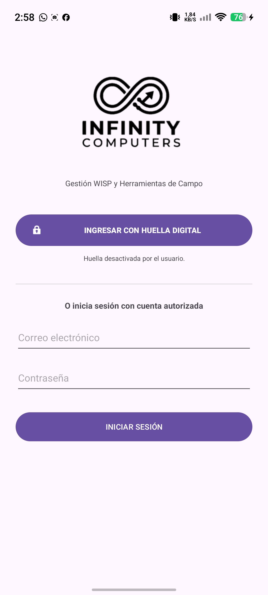
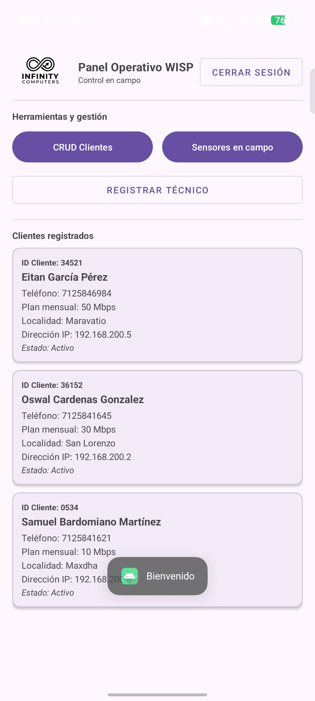
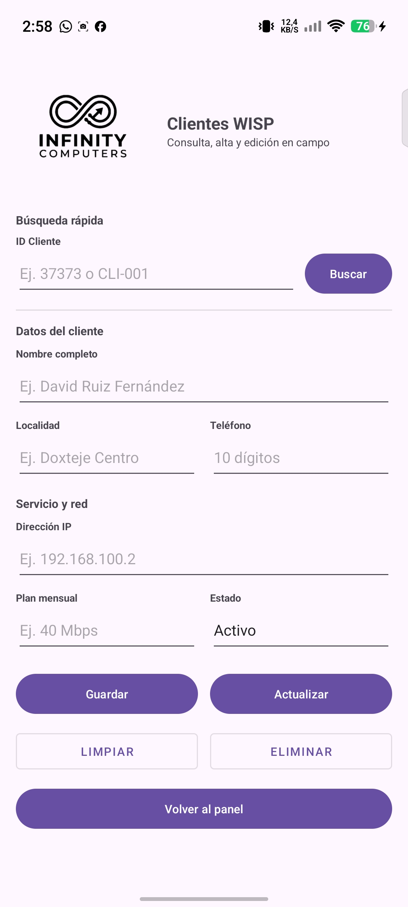
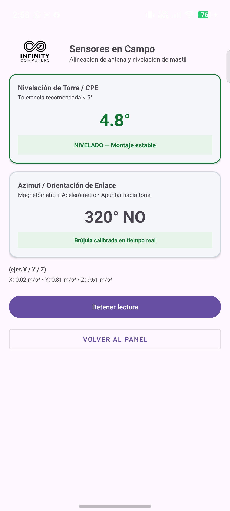

# InfinityComputers — App Móvil de Gestión WISP y Diagnóstico en Campo

Aplicación móvil nativa para Android desarrollada en **Kotlin** con **ViewBinding** y autenticación biométrica (**BiometricPrompt**). Diseñada para técnicos de campo de un proveedor de internet inalámbrico (WISP), permitiendo gestionar clientes en tiempo real, dar de alta personal técnico y utilizar los sensores del dispositivo para nivelar mástiles y orientar antenas.

---

## Características principales

- **Autenticación Biométrica Obligatoria (`BiometricPrompt`):** Primera pantalla protegida por huella dactilar con manejo de errores (sin sensor, sin huellas registradas, huella no reconocida, cancelación y bloqueo por intentos fallidos) y bloqueo de navegación hacia atrás sin autenticar.
- **Panel Operativo en Tiempo Real (`RecyclerView` + Firestore):** Visualización dinámica de clientes WISP sincronizada automáticamente mediante `SnapshotListener` y cierre de sesión seguro.
- **Gestión CRUD de Clientes:** Alta, consulta (búsqueda rápida por ID o nombre completo), actualización y eliminación de suscriptores con validación de campos en **Cloud Firestore**.
- **Registro de Técnicos (`Firebase Authentication`):** Alta de nuevas cuentas de acceso mediante correo electrónico y contraseña con validación de formato y longitud mínima.
- **Herramientas y Sensores en Campo:** Tablero diagnóstico que combina el **acelerómetro** y el **magnetómetro** del dispositivo para medir inclinación de mástil (con semáforo visual verde/ámbar/rojo) y calcular el azimut magnético (0°–360° con punto cardinal) para alineación de enlaces.

---

## Tecnologías y librerías utilizadas

- **Lenguaje:** Kotlin
- **Interfaz y Arquitectura:** XML con Material Design, **ViewBinding** al 100 % (sin `findViewById`), recursos centralizados en `strings.xml` y `colors.xml`.
- **Seguridad Biométrica:** `androidx.biometric:biometric`
- **Backend y Persistencia:** Firebase Authentication y Cloud Firestore (`com.google.firebase:firebase-bom`)
- **Sensores de Hardware:** Android Sensor Framework (`SensorManager`, `TYPE_ACCELEROMETER`, `TYPE_MAGNETIC_FIELD`)
- **SDK mínimo:** `minSdk 24` (Android 7.0 Nougat)

---

## Capturas de pantalla

|               Inicio de sesión con huella                |               Panel operativo WISP                |
|:--------------------------------------------------------:|:-------------------------------------------------:|
|  |  |

|              Gestión CRUD de clientes              |                    Sensores en campo                    |
|:--------------------------------------------------:|:-------------------------------------------------------:|
|  |  |

---

## Estructura del proyecto

```text
app/src/main/
├── java/com/example/infinitycomputers/
│   ├── data/
│   │   └── ClienteWisp.kt              # Modelo de datos de suscriptores WISP
│   ├── ui/adapter/
│   │   └── ClienteWispAdapter.kt       # Adaptador personalizado para RecyclerView
│   ├── MainActivity.kt                 # Pantalla inicial con autenticación biométrica
│   ├── PanelActivity.kt                # Menú operativo, cierre de sesión y lista en tiempo real
│   ├── CrudClientesActivity.kt         # Operaciones CRUD y búsqueda por ID/nombre
│   ├── RegistrarTecnicoActivity.kt     # Alta de técnicos con Firebase Authentication
│   └── SensoresCampoActivity.kt        # Nivelación de mástil y brújula de alineación
└── res/
    ├── layout/                         # Vistas XML enlazadas con ViewBinding
    └── values/                         # strings.xml y colors.xml centralizados

Instalación y ejecución
Clonar este repositorio:

Bash
git clone [https://github.com/davidruizfernandez06-gif/infinitycomputers.git](https://github.com/davidruizfernandez06-gif/infinitycomputers.git)
Abrir el proyecto en Android Studio (versión Hedgehog / Jellyfish / Ladybug o superior).

Colocar tu archivo google-services.json dentro de la carpeta app/ con Firebase Authentication (Correo/Contraseña) y Cloud Firestore habilitados.

Sincronizar Gradle (Sync Project with Gradle Files).

Ejecutar la aplicación en un dispositivo físico Android (API 24+) con sensor de huella dactilar configurado, acelerómetro y magnetómetro.

Autor
David Ruiz Fernández — Ingeniería en Tecnologías de la Información e Innovación Digital (Grupo ITI-401, Universidad Politécnica de Atlacomulco)